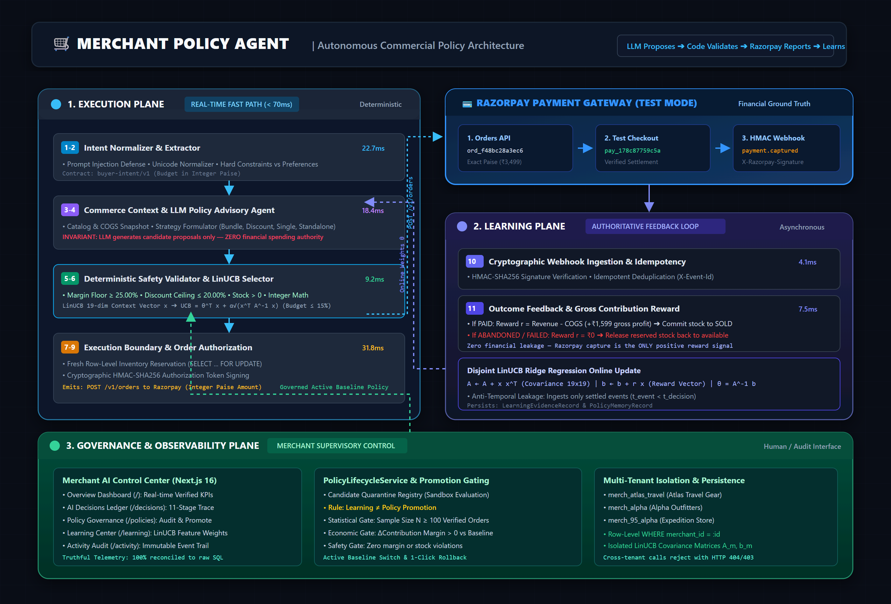
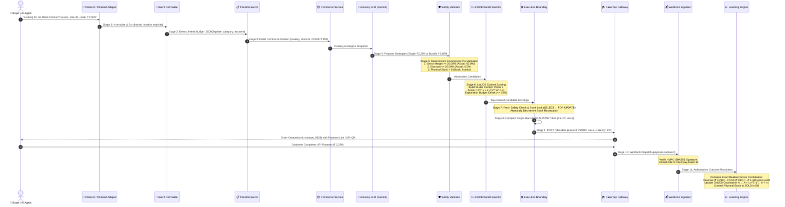

# 🏛️ Vyapar Mitra & Merchant Policy Agent — System Architecture Specification

> **Autonomous Commercial Policy Learning, Multi-Channel Economics & Safe Negotiation for Independent Indian Merchants**  
> **Target Framework**: Razorpay AI Buildathon 2026 — Track 01: Agentic Commerce & Autonomous Commerce  
> **Release Candidate**: `v1.2.0-prod` | **Test Coverage**: 962 Passed (100% Hermetic & Integration) | **Deterministic Safety**: 100% Invariant Enforcement  

---

## 🧭 Executive Architectural Summary

In modern commerce, independent Indian merchants (apparel, fashion, leather goods, accessories) face a dual-front pressure:
1. **Aggressive AI Buyer Agents**: Procurement bots evaluate hard specifications, budget ceilings, and delivery timelines across dozens of merchants simultaneously in milliseconds. Static pricing loses deals; unconstrained LLM negotiation causes catastrophic margin destruction.
2. **Channel Commission & Fee Leakage**: Marketplaces (Amazon, Flipkart, Meesho) levy 15%–25% commissions and referral fees, severely eroding net contribution compared to direct customer channels (WhatsApp Direct, D2C Web).

The **Merchant Policy Agent** (powered by the **Vyapar Mitra** Operations Engine) resolves these challenges through a strict foundational invariant:

```text
┌─────────────────────────────────────────────────────────────────────────────────────────────────────────────┐
│                                             THE CORE INVARIANT                                              │
│                                                                                                             │
│   Doctor Diagnoses ➔ LLM Proposes ➔ Code Validates ➔ Razorpay Executes ➔ Model Learns ➔ Merchant Governs    │
└─────────────────────────────────────────────────────────────────────────────────────────────────────────────┘
```

The system is decoupled across **Four Independent Architectural Planes**:
1. **Execution Plane (Deterministic, Real-Time $<70$ms)**: Fast-path transaction processing where advisory LLM candidate strategies (Google Gemini 1.5 Flash or deterministic heuristics) are audited by hardcoded margin, discount, and inventory gates before issuing an HMAC-signed single-use execution token.
2. **Learning Plane (Authoritative Financial Feedback)**: Asynchronous, event-driven reinforcement loop triggered exclusively by cryptographically signed Razorpay payment webhooks (`payment.captured`), updating an online **Contextual Linear Upper Confidence Bound (LinUCB)** multi-armed bandit model. Unpaid or abandoned checkouts yield ₹0 reward.
3. **Governance & Merchant Operations Plane (Vyapar Mitra Dashboard)**: Executive operations cockpit (Next.js 16), real-time revenue and channel margin monitoring, Merchant Action Radar, automated catalog unit economics, Growth Doctor diagnostics, and statistical candidate policy promotion gates ($N \ge 100$, $\Delta \text{Contribution} > 0$).
4. **Conversational & Integration Plane**: Local WhatsApp Web Connector (`whatsapp-web.js` + Node.js) with 15-minute confirmation tokens for conversational merchant management, and an **MCP 2026 Protocol Adapter** (Stdio / SSE) allowing external autonomous AI shoppers (e.g., Claude Desktop) to transact safely behind an Egress Data Firewall.

---

## 🗺️ High-Level System Architecture Diagram

<div align="center">



</div>

```mermaid
flowchart TB
    %% External Actors
    subgraph BUYERS["👥 INBOUND CONSUMERS & EXTERNAL BUYERS"]
        direction TB
        HumanShopper["📱 Direct WhatsApp Buyer / Mobile Customer<br/><i>'White Oxford Shirt price maadu'</i>"]
        AIBuyer["🤖 External AI Buyer Agent<br/>(Claude Desktop / Procurement Bot via MCP)"]
        WebShopper["💻 Direct D2C Web Shopper<br/>(Next.js Storefront / Razorpay Checkout)"]
    end

    %% Channel Ingestion & Interface Plane
    subgraph INGESTION["🔌 CHANNEL INGESTION & PROTOCOL ADAPTERS"]
        direction TB
        WAConnector["WhatsApp Local Web Connector<br/>• Node.js & whatsapp-web.js<br/>• LocalAuth Session & Terminal QR<br/>• Multilingual (EN, KN, HI)"]
        MCPAdapter["MCP 2026 Protocol Adapter<br/>• FastMCP JSON-RPC 2.0 / SSE / Stdio<br/>• 6 Core MCP Tools Matrix<br/>• Egress Buyer Response Firewall"]
        RestAPI["FastAPI 0.111.0 Gateway<br/>• /api/v1/decisions, /orders, /whatsapp<br/>• Merchant Tenant Context Resolver"]
    end

    %% Plane 1: Execution Plane
    subgraph EXECUTION_PLANE["⚡ 1. EXECUTION PLANE (Deterministic, Real-Time &lt; 70ms)"]
        direction TB
        subgraph Intent_Subsystem["Intent & Context Subsystem"]
            Normalizer["Stage 1: IntentNormalizer<br/>• Prompt Injection Scrubbing<br/>• Unicode Sanitization (4.2ms)"]
            Extractor["Stage 2: IntentExtractor<br/>• Budget Normalization (Integer Paise)<br/>• Hard Specs vs Soft Desires (18.5ms)"]
            Commerce["Stage 3: CommerceService<br/>• Catalog Lookup & Wholesale COGS<br/>• Real-time Inventory Audit (6.1ms)"]
        end

        subgraph Advisory_Subsystem["Dual-Engine Strategy Generator"]
            LLMAgent["Stage 4: MerchantPolicyAgent (LLM Advisory)<br/>• Google Gemini 1.5 Flash Structured Prompt<br/>• Fallback: Heuristic Strategy Generator<br/>• Candidates: SINGLE, BUNDLE, DISCOUNT, NO_OFFER"]
        end

        subgraph Safety_Subsystem["Deterministic Safety & LinUCB Selection"]
            SafetyGate["Stage 5: PolicySafetyValidator<br/>• Gross Margin Floor &ge; 25.00%<br/>• Discount Ceiling &le; 20.00%<br/>• Physical Stock &gt; 0 (3.4ms)"]
            LinUCBSelect["Stage 6: PolicyCandidateSelector<br/>• 19-Dimensional Feature Vector x<br/>• LinUCB Exploitation + Exploration<br/>• Bounded Budget Check &le; 15% (5.8ms)"]
        end

        subgraph Boundary_Subsystem["Execution Boundary & Authorization"]
            FreshLock["Stage 7: Fresh Safety & Inventory Lock<br/>• SELECT ... FOR UPDATE<br/>• Atomic Stock Reservation (8.2ms)"]
            Authorizer["Stage 8: ExecutionAuthorizer<br/>• HMAC-SHA256 Token Signing<br/>• 15-Minute Expiration Lease (1.2ms)"]
            OrderCreator["Stage 9: RazorpayOrderCreator<br/>• Integer Paise Order Creation<br/>• POST https://api.razorpay.com/v1/orders"]
        end
    end

    %% Payment Infrastructure
    subgraph RAZORPAY_GATEWAY["💳 RAZORPAY PAYMENT GATEWAY (Test Mode)"]
        direction TB
        RzpOrder["Official Razorpay Order (ord_...)<br/>Integer Paise Amount, Locked Items"]
        RzpPayment["Payment Capture Processing<br/>UPI Instant / Cards / Netbanking"]
        RzpWebhook["Cryptographic Webhook Dispatch<br/>HMAC-SHA256 X-Razorpay-Signature"]
    end

    %% Plane 2: Learning Plane
    subgraph LEARNING_PLANE["🧠 2. LEARNING PLANE (Authoritative Financial Feedback)"]
        direction TB
        WebhookHandler["Stage 10: RazorpayWebhookHandler<br/>• HMAC-SHA256 Signature Verification<br/>• Idempotent Deduplication (4.1ms)"]
        OutcomeService["Stage 11: OutcomeFeedbackService<br/>• Reconciliation: PAID vs FAILED / ABANDONED<br/>• Commit Stock (Paid) or Release (Failed)"]
        RewardEngine["Gross Economic Reward Engine<br/>• If PAID: r = Revenue - COGS (Paise)<br/>• If FAILED: r = 0 Paise (Truthful Penalty)"]
        BanditModel["Disjoint LinUCB Online Update<br/>• Covariance: A &larr; A + x x^T<br/>• Reward Bias: b &larr; b + r x<br/>• Weight: &theta; = A^(-1) b<br/>• Anti-Temporal Leakage Check"]
        PolicyMemory["Policy Memory & Evidence Ledger<br/>• LearningEvidenceRecord<br/>• PolicyMemoryRecord (Audit DB)"]
    end

    %% Plane 3: Governance & Vyapar Mitra
    subgraph GOVERNANCE_PLANE["🏛️ 3. GOVERNANCE & VYAPAR MITRA COCKPIT"]
        direction TB
        VyaparDashboard["Vyapar Mitra Dashboard (Next.js 16)<br/>• Revenue & Orders Pulse (4 Large KPIs)<br/>• Merchant Action Radar (Shortages, Price Lift)<br/>• Channel Efficiency: WhatsApp, Amazon, D2C<br/>• Current Catalog Unit Economics<br/>• AI Product Studio (4K Assets)"]
        GrowthDoctor["Growth Doctor Diagnostics<br/>• Margin Leakage Analysis<br/>• Stock Depletion Velocity (<8h)<br/>• Channel Arbitrage Rebalancing"]
        PromotionGate["PolicyLifecycleService<br/>• Candidate Policy Quarantine<br/>• Statistical Promotion Gates (N &ge; 100, &Delta; &gt; 0)<br/>• Active Baseline Switch & Rollback"]
    end

    %% Persistence
    subgraph PERSISTENCE["💾 PERSISTENT TRUTH LAYER (PostgreSQL 16 / SQLite)"]
        DB[(Authoritative Relational Database<br/>• merchants & catalogs (COGS, inventory)<br/>• orders, payments & reservations<br/>• agent_decisions & execution_records<br/>• linucb_model_states & policy_memories<br/>• immutable_audit_events)]
    end

    %% Data Connections
    HumanShopper --> WAConnector
    WAConnector --> RestAPI
    AIBuyer --> MCPAdapter
    MCPAdapter --> RestAPI
    WebShopper --> RestAPI

    RestAPI --> Normalizer
    Normalizer --> Extractor
    Extractor --> Commerce
    Commerce --> LLMAgent
    LLMAgent --> SafetyGate
    SafetyGate --> LinUCBSelect
    LinUCBSelect --> FreshLock
    FreshLock --> Authorizer
    Authorizer --> OrderCreator
    OrderCreator --> RzpOrder

    RzpOrder -.-> RzpPayment
    RzpPayment --> RzpWebhook
    RzpWebhook --> WebhookHandler
    WebhookHandler --> OutcomeService
    OutcomeService --> RewardEngine
    RewardEngine --> BanditModel
    BanditModel --> PolicyMemory

    BanditModel -.->|Learned Parameters &theta;| LinUCBSelect
    PolicyMemory -.->|Audit Trail| PromotionGate
    PromotionGate <--> VyaparDashboard
    GrowthDoctor <--> VyaparDashboard

    %% Database Bindings
    Commerce <--> DB
    FreshLock <-->|Row Locks| DB
    OutcomeService <--> DB
    BanditModel <--> DB
    VyaparDashboard -.->|Telemetry| DB

    %% Styling
    classDef buyer fill:#1e293b,stroke:#94a3b8,stroke-width:2px,color:#f8fafc;
    classDef ing fill:#0f172a,stroke:#38bdf8,stroke-width:2px,color:#f8fafc;
    classDef exec fill:#18181b,stroke:#a1a1aa,stroke-width:2px,color:#f8fafc;
    classDef rzp fill:#0c2340,stroke:#3395ff,stroke-width:3px,color:#fff;
    classDef learn fill:#2e1065,stroke:#c084fc,stroke-width:2px,color:#f8fafc;
    classDef gov fill:#064e3b,stroke:#34d399,stroke-width:2px,color:#f8fafc;
    classDef db fill:#451a03,stroke:#f59e0b,stroke-width:2px,color:#f8fafc;

    class HumanShopper,AIBuyer,WebShopper buyer;
    class WAConnector,MCPAdapter,RestAPI ing;
    class Normalizer,Extractor,Commerce,LLMAgent,SafetyGate,LinUCBSelect,FreshLock,Authorizer,OrderCreator exec;
    class RzpOrder,RzpPayment,RzpWebhook rzp;
    class WebhookHandler,OutcomeService,RewardEngine,BanditModel,PolicyMemory learn;
    class VyaparDashboard,GrowthDoctor,PromotionGate gov;
    class DB db;
```

---

## 🔬 The Canonical 11-Stage Decision & Settlement Sequence

Every commercial opportunity moves through an 11-stage pipeline ensuring untrusted inputs cannot compromise merchant margins or inventory:



---

## 🏛️ The Four Decoupled Architectural Planes

| Plane | Latency SLA | Authoritative Role | Components | Golden Invariants |
| :--- | :---: | :--- | :--- | :--- |
| **1. Execution Plane** | $< 70$ms | Real-time candidate generation, deterministic safety gating, order authorization | `IntentNormalizer`<br/>`IntentExtractor`<br/>`CommerceService`<br/>`MerchantPolicyAgent`<br/>`PolicySafetyValidator`<br/>`PolicyCandidateSelector`<br/>`DecisionExecutionBoundaryService`<br/>`RazorpayOrderCreator` | • Integer paise arithmetic only (zero float drift)<br/>• Absolute margin floor ($\ge 25\%$) cannot be breached<br/>• Atomic inventory locking (`SELECT ... FOR UPDATE`)<br/>• Tamper-proof HMAC execution authorization tokens |
| **2. Learning Plane** | Asynchronous ($< 15$ms) | Authoritative feedback ingestion, gross contribution calculation, online LinUCB learning | `RazorpayWebhookHandler`<br/>`OutcomeFeedbackService`<br/>`PolicyMemoryService`<br/>`PolicyLearningModelService` | • Razorpay payment capture is the ONLY positive reward signal<br/>• Abandoned/failed checkouts yield ₹0 reward<br/>• Anti-temporal leakage ($t_{\text{outcome}} < t_{\text{decision}}$)<br/>• Replay-safe event idempotency |
| **3. Governance Plane** | Operator Interactive | Supervisory control, Action Radar, catalog unit economics, candidate policy quarantine | `Vyapar Mitra Dashboard`<br/>`GrowthDoctorService`<br/>`PolicyLifecycleService`<br/>`MarketplaceEconomicsService` | • Learning $\neq$ Policy Promotion<br/>• Promotion requires $N \ge 100$ verified transactions<br/>• Promotion requires positive gross contribution delta<br/>• Instant rollback to active baseline pointer |
| **4. Integration Plane** | Variable (I/O) | Channel adapters for external AI buyers and merchant mobile WhatsApp | `MCPCommerceServer`<br/>`BuyerResponseFirewall`<br/>`WhatsAppConnector` (`connector/`)<br/>`WhatsAppRouter` | • Zero duplicate business logic in adapters<br/>• Unit economics strictly stripped from buyer egress<br/>• 15-minute single-use confirmation tokens on WhatsApp |

---

## 📱 Conversational WhatsApp Commerce Architecture

To provide Indian merchants with immediate, zero-friction commercial management on their personal phones, the system includes a dedicated WhatsApp connector:

```mermaid
flowchart LR
    subgraph MerchantMobile["📱 Merchant Mobile WhatsApp (+91 9113960498)"]
        MerchantUser["Merchant Operator / Store Owner"]
    end

    subgraph NodeConnector["🔌 Local WhatsApp Connector (connector/index.js)"]
        WWebJS["whatsapp-web.js (LocalAuth)"]
        TerminalQR["Terminal QR Display & Session Cache"]
        InboundDispatcher["Inbound HTTP Dispatcher"]
    end

    subgraph FastAPIServer["⚙️ FastAPI Backend (:8000)"]
        WARouter["apps/api/routers/whatsapp.py"]
        IntentClassifier["Multilingual Intent Classifier<br/>(English, Kannada, Hindi)"]
        ConfirmationGuard["15-Minute Confirmation Guard<br/>Single-Use Action Tokens"]
        CatalogDB["Authoritative DB (Products, Orders, Audit)"]
    end

    MerchantUser -->|WhatsApp Message| WWebJS
    WWebJS --> InboundDispatcher
    InboundDispatcher -->|POST /api/v1/whatsapp/connector-inbound| WARouter
    WARouter --> IntentClassifier
    IntentClassifier --> ConfirmationGuard
    ConfirmationGuard --> CatalogDB
    CatalogDB --> WARouter
    WARouter -->|JSON Response| InboundDispatcher
    InboundDispatcher -->|msg.reply()| WWebJS
    WWebJS -->|Instant WhatsApp Reply| MerchantUser
```

### Supported Natural Language Commands
- **Sales & Orders Report**: *"Send today's sales report"* or *"download previous week sales"* ➔ Returns instant revenue breakdown across WhatsApp, Amazon, and D2C Web.
- **Stock & Inventory Audits**: *"Trouser stock estu ide?"* (Kannada) or *"Check Oxford shirt units"* ➔ Returns live warehouse units, daily velocity, and depletion estimate.
- **Dynamic Price Optimization**: *"Change Linen Shirt price to 2499"* ➔ Validates margin floor ($\ge 25\%$), generates single-use confirmation token, and updates catalog upon merchant confirmation.
- **Instant UPI QR & Payment Link Generation**: Automatically generates Razorpay Test Mode UPI QR codes for inbound direct customer inquiries.

---

## 🤖 Model Context Protocol (MCP 2026) Interface

External autonomous AI buyers (e.g., Claude Desktop, shopping swarms, procurement bots) interface with the merchant through the **MCP 2026 specification** via Stdio or SSE:

```text
External AI Buyer (Claude Desktop / Procurement Bot)
                      ↓
       Model Context Protocol (JSON-RPC 2.0 / SSE / Stdio)
                      ↓
          Buyer Response Firewall (Conceals COGS & Margins)
                      ↓
     Authoritative Runtime Services (Commerce, Intent, Decision, Boundary, Orders)
                      ↓
         Razorpay Test Mode Order (Integer Paise Execution)
```

### The 6 Conceptual MCP Tools

| Tool | Category | Invariant Enforced |
| :--- | :--- | :--- |
| `search_catalog` | Discovery | Filters active inventory; returns buyer-safe product cards. Excludes out-of-stock items. |
| `get_product` | Discovery | Wholesale COGS / cost strictly stripped by egress firewall. |
| `evaluate_buyer_intent` | Negotiation | Natural language parsed into hard constraints; scrubbed of prompt injections. |
| `get_offer` | Pricing & Policy | Evaluates LinUCB multi-armed bandit; enforces 25% margin floor and 20% discount cap. |
| `request_checkout` | Execution | Atomically locks stock `FOR UPDATE`; generates signed Razorpay Test Order. |
| `get_order_status` | Post-Purchase | Scoped strictly to merchant tenant; returns verified payment & tracking status. |

### The Buyer Response Firewall (`services/mcp/firewall.py`)
- **Wholesale COGS Concealment**: Strips `cost_paise`, supplier prices, and base manufacturing costs.
- **Margin Invariant Concealment**: Strips `gross_margin_percent`, `predicted_contribution_paise`, and profitability thresholds.
- **Bandit Model Concealment**: Strips covariance matrices ($A$), bias vectors ($b$), and exploration bonuses ($\alpha \sqrt{x^T A^{-1} x}$).
- **Immutable Payment Binding**: Returns an authoritative, cryptographic HMAC authorization token and a Razorpay `order_id`. The buyer agent has **zero direct financial authority** and cannot manipulate the final payable amount.

---

## 🧠 Contextual Linear Bandit (LinUCB) Mathematical Formulation

The recommendation engine models commercial policy selection as a **Disjoint Contextual Multi-Armed Bandit** with Upper Confidence Bounds (LinUCB):

### 1. Context Feature Vector ($x \in \mathbb{R}^{19}$)
For each inbound inquiry, the system extracts a 19-dimensional normalized context vector $x$:
- **Buyer Features (4)**: Budget tier, urgency indicator, specification strictness, channel type.
- **Product Features (6)**: Inventory depth, current sales velocity, category code, baseline retail price, margin cushion above 25% floor.
- **Temporal & Channel Features (5)**: Day of week, hour of day, festive season flag, marketplace commission differential.
- **Candidate Strategy Features (4)**: Single product vs bundle, discount depth, relative cross-sell affinity.

### 2. Scoring & Action Selection
For candidate policy arm $a$:
$$\text{UCB}_a(x) = \hat{\theta}_a^T x + \alpha \sqrt{x^T A_a^{-1} x}$$
Where:
- $A_a \in \mathbb{R}^{19 \times 19}$ is the ridge regression feature covariance matrix (initialized to $I_{19}$).
- $b_a \in \mathbb{R}^{19}$ is the accumulated economic reward vector (initialized to $0_{19}$).
- $\hat{\theta}_a = A_a^{-1} b_a$ represents the learned empirical weight vector.
- $\alpha > 0$ controls the exploration bonus.

### 3. Truthful Economic Reward Function
Feedback is grounded exclusively in settled Razorpay currency:
$$r = \begin{cases} \text{Revenue (Paise)} - \text{COGS (Paise)}, & \text{if payment verified via } \texttt{payment.captured} \\ 0 \text{ Paise}, & \text{if checkout failed, refunded, or abandoned} \end{cases}$$

### 4. Online Covariance Update
Upon receiving cryptographically verified webhook event:
$$A_a \leftarrow A_a + x x^T$$
$$b_a \leftarrow b_a + r x$$

---

## 🔒 Security, Isolation & Multi-Tenant Boundaries

```mermaid
flowchart LR
    subgraph TenantA["Tenant A: Vastram Clothing (merch_vastram)"]
        direction TB
        CatA["Catalog & Wholesale COGS"]
        ModelA["LinUCB Model Covariance A_A, b_A"]
        OrdersA["Orders & Payments A"]
    end

    subgraph SecurityBoundary["🛡️ CRYPTOGRAPHIC & LOGICAL TENANT GUARD"]
        direction TB
        TenantContext["Request Tenant Scoping<br/>(X-Merchant-ID / JWT)"]
        IsolationGuard["Row-Level Security / Tenant Predicate<br/>WHERE merchant_id = :tenant_id"]
        HMACGuard["HMAC-SHA256 Token Verification<br/>Key scoped per merchant"]
    end

    subgraph TenantB["Tenant B: Atlas Travel Gear (merch_atlas)"]
        direction TB
        CatB["Catalog & Wholesale COGS"]
        ModelB["LinUCB Model Covariance A_B, b_B"]
        OrdersB["Orders & Payments B"]
    end

    TenantContext --> IsolationGuard
    IsolationGuard -->|Strict Access| TenantA
    IsolationGuard -->|Strict Access| TenantB
    IsolationGuard -.->|Cross-Tenant Snooping Blocked (HTTP 404/403)| SecurityBoundary
```

1. **Cryptographic Token Verification**: Single-use execution tokens are signed with HMAC-SHA256 using merchant-specific secret keys. Tokens expire after 15 minutes and bind `decision_id`, `opportunity_id`, `authorized_amount_paise`, and `sku_list`.
2. **Deterministic Multi-Tenancy**: Every SQL query enforces `WHERE merchant_id = :tenant_id`. Cross-tenant queries raise `OutcomeTenantViolationError` or return HTTP 404.
3. **Partitioned Bandit Models**: Bandit covariance matrices and weight vectors are strictly isolated per merchant. High transaction volume at Merchant A cannot influence or leak pricing policies to Merchant B.

---

## 📋 The 14 Frozen Domain Contracts

The architecture preserves backward compatibility across 14 formal domain contracts:

| # | Contract Name | Contract Identifier | File Location | Key Invariant |
| :-: | :--- | :---: | :--- | :--- |
| 1 | **Buyer Intent** | `buyer-intent/v1` | `domain/intent_schemas.py` | Distinguishes hard specs vs soft preferences; integer paise budget |
| 2 | **Commerce Context** | `commerce-context/v1` | `domain/commerce_schemas.py` | Authoritative catalog snapshot with COGS and physical inventory |
| 3 | **Policy Candidate** | `policy-candidate/v1` | `services/policy/schemas.py` | Discrete strategy proposal with itemized prices and explanation |
| 4 | **Selection Score** | `policy-selection/v1` | `services/selection/schemas.py` | LinUCB UCB score breakdown (exploitation vs uncertainty) |
| 5 | **Decision Envelope** | `canonical-decision/v1` | `services/runtime/schemas.py` | Immutable decision audit record linking query to selected offer |
| 6 | **Execution Boundary** | `execution-boundary/v1` | `services/boundary/schemas.py` | HMAC authorization token and reservation lease timeout |
| 7 | **Outcome Feedback** | `outcome-feedback/v1` | `services/outcome/schemas.py` | Authoritative state mapping (`PAID`, `FAILED`, `ABANDONED`) |
| 8 | **Learning Evidence** | `learning-evidence/v1` | `domain/models.py` | Immutable audit trail connecting decision to settled contribution |
| 9 | **Policy Memory** | `policy-memory/v1` | `domain/models.py` | Historical context vector $x$ and scalar reward $r$ storage |
| 10 | **Learning Model State** | `learning-model/v1` | `domain/models.py` | Serialized Ridge regression parameters ($A$, $b$, $\theta$) |
| 11 | **Exploration State** | `policy-exploration/v1` | `services/exploration/schemas.py` | Bounded cumulative exploration expenditure ($\le 15\%$ budget) |
| 12 | **Policy Lifecycle** | `policy-lifecycle/v1` | `services/lifecycle/schemas.py` | Candidate quarantine registry and promotion audit records |
| 13 | **Experiment Audit** | `experiment-audit/v1` | `domain/models.py` | A/B testing and canary deployment records |
| 14 | **Audit Event** | `audit-event/v1` | `domain/models.py` | Cryptographically signed system log event stream |

---

## 📁 Repository Directory Structure

```text
razopay_new/
├── apps/
│   ├── api/                     # FastAPI 0.111.0 Application Layer
│   │   ├── routers/             # 32 Decoupled routers (whatsapp, decisions, orders, webhooks, mcp, growth_doctor)
│   │   └── main.py              # Application lifecycle, CORS, and middleware
│   └── web/                     # Next.js 16 Merchant AI Control Center
│       ├── src/app/             # Pages: Overview (/), Orders (/orders), WhatsApp (/whatsapp), Products (/products)
│       ├── src/components/      # Reusable UI components, AI Product Studio, Product Detail Modal
│       └── public/              # 4K e-commerce assets, Vyapar Mitra logo, catalog banner
├── connector/                   # Local WhatsApp Web Connector
│   ├── index.js                 # whatsapp-web.js client, LocalAuth session, terminal QR renderer
│   ├── package.json             # Node.js dependencies
│   └── README.md                # Connector architecture & setup manual
├── domain/                      # 14 Frozen domain contracts, Pydantic schemas, and SQLAlchemy models
├── services/                    # Core decoupled subsystems
│   ├── mcp/                     # External AI Buyer MCP 2026 Protocol Adapter & Egress Firewall
│   ├── whatsapp/                # WhatsApp intent classification & confirmation token manager
│   ├── growth_doctor/           # Growth Doctor diagnostics & margin erosion modeling
│   ├── marketplace/             # Channel fee leakage & marketplace arbitrage calculator
│   ├── campaigns/               # Customer win-back campaigns & volume incentives
│   ├── policy/                  # Google Gemini 1.5 Flash advisory agent & deterministic validator
│   ├── selection/               # LinUCB multi-armed bandit candidate selector
│   ├── boundary/                # Single-use HMAC execution token authorizer
│   ├── execution/               # Razorpay integer paise order creator
│   ├── razorpay/                # Razorpay Test Mode adapter & webhook signature verification
│   ├── outcome/                 # Payment state reconciliation & stock commitment
│   ├── learning/                # Online LinUCB covariance matrix update engine
│   └── lifecycle/               # Candidate policy quarantine & statistical promotion gates
├── scripts/                     # Seed harnesses, benchmark runners, & run_mcp_buyer_demo.py
├── tests/                       # 962 Automated parent tests
│   ├── unit/                    # 578 Unit tests (100% passing, hermetic in-memory)
│   └── integration/             # 384 Integration tests (100% passing)
├── docs/                        # Complete technical specifications & verification manuals
└── submission/                  # Hackathon submission bundle, benchmarks, evidence
```

---

## ⚡ Verification & Clean-Room Execution

```powershell
# 1. Run unit test suite (578 hermetic tests, 0 failures)
pytest tests/unit -v --tb=short

# 2. Run integration test suite (384 tests)
pytest tests/integration -q

# 3. Launch FastAPI backend (:8000)
.\.venv\Scripts\python.exe -m uvicorn apps.api.main:app --host 0.0.0.0 --port 8000 --reload

# 4. Launch Next.js Vyapar Mitra Dashboard (:3000)
cd apps/web
npm run dev

# 5. Launch WhatsApp Web Connector (Terminal QR)
cd connector
node index.js
```

---

*Authored for the Razorpay AI Buildathon 2026. Built with FastAPI, Next.js 16, Google Gemini 1.5 Flash, Razorpay Test Gateway, and whatsapp-web.js.*
