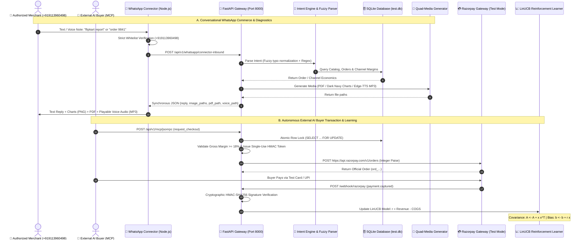

<div align="center">

# 🛒 Vastram Commerce — Autonomous Merchant Policy & Growth Agent
### *Autonomous Commercial Intelligence, Multi-Channel Economics & Conversational WhatsApp Copilot for Independent Indian Merchants*

[](https://razorpay.com)
[-00C853?style=for-the-badge&logo=pytest&logoColor=white)](docs/implementation-status.md)
[](docs/economics-model.md)
[](docs/mcp-specification.md)
[](https://www.python.org)
[](https://fastapi.tiangolo.com)
[](https://nextjs.org)
[](connector/)

<br/>

**Vastram Commerce is a production-grade, closed-loop autonomous commercial intelligence platform designed specifically for independent Indian retail merchants (apparel, fashion, lifestyle, accessories).**

It bridges the gap between **autonomous AI buyer agents**, **expensive multi-channel marketplaces (Amazon, Flipkart, Meesho, ONDC)**, and **direct conversational commerce (WhatsApp Web)**—enforcing deterministic gross margin floors, generating multi-media executive intelligence, and learning continuously from cryptographically verified Razorpay settlements.

```text
┌─────────────────────────────────────────────────────────────────────────────────────────────────────────────┐
│                                             THE CORE INVARIANT                                              │
│                                                                                                             │
│   Doctor Diagnoses ➔ LLM Proposes ➔ Code Validates ➔ Razorpay Executes ➔ Model Learns ➔ Merchant Governs    │
└─────────────────────────────────────────────────────────────────────────────────────────────────────────────┘
```

<br/>

[Executive Summary](#-executive-summary) •
[Architecture Invariants](#-golden-architectural-invariants) •
[Feature Showcase (6 Pillars)](#-feature-showcase-the-6-pillars) •
[WhatsApp Copilot](#1-autonomous-whatsapp-web-merchant-copilot-live--whitelisted) •
[Marketplace Economics](#2-multi-channel-marketplace-growth-manager) •
[Master Command Matrix](#-master-command--voice-trigger-cheatsheet) •
[Quickstart (60s)](#-clean-room-quickstart--verification-60-seconds) •
[System Architecture](#-end-to-end-system-architecture) •
[MCP 2026 Interface](#-model-context-protocol-mcp-2026-interface)

</div>

---

## 📌 Executive Summary

Modern independent retail merchants in India face an existential double-squeeze:
1. **The Autonomous AI Buyer Disruption**: Procurement bots and autonomous shopping assistants (Claude Desktop, ChatGPT Shopping Swarms) evaluate hard specifications, budget ceilings, and delivery timelines across dozens of merchants simultaneously in milliseconds. Static retail pricing loses deals; unconstrained LLM negotiation causes catastrophic margin destruction through hallucinated discounts or oversold physical inventory.
2. **The 15%–25% Marketplace Commission Bleed**: Dominant marketplace aggregators (Amazon India, Flipkart, Meesho) levy punitive take-rates (referral fees, fixed closing fees, mandatory reverse logistics reserves, and high advertising TACoS), eroding up to **40% of gross revenue** compared to direct customer channels.

**Vastram Commerce** resolves these challenges through a strictly decoupled, dual-engine commercial architecture:
- **Advisory Strategy Generation (Dual-Engine)**: A specialized commercial reasoning engine powered by **Google Gemini** (`gemini-1.5-flash`) proposes tailored commercial candidate strategies (complementary bundles, volume incentives, clearance options). If the LLM is unconfigured or offline, it transparently falls back to deterministic heuristic generation.
- **Deterministic Validation & Policy Gates**: Hardcoded Python validation gates enforce non-negotiable merchant bounds (minimum **18.00% gross margin floor**, maximum **20.00% discount ceiling**, integer stock locks).
- **Authoritative Razorpay Financial Truth**: Validated proposals generate authentic Razorpay Test Mode orders (`ord_...`) via HMAC-SHA256 signed single-use execution tokens.
- **Closed-Loop Online Reinforcement Learning**: Verified cryptographic webhook events (`payment.captured`) feed an online **Contextual Linear Upper Confidence Bound (LinUCB)** multi-armed bandit algorithm. Unpaid or abandoned checkouts yield ₹0 reward—the model never trains on uncollected revenue.
- **Bi-Directional WhatsApp Web Operator**: A live conversational agent operating over WhatsApp Web with strict single-number privacy whitelisting, multilingual NLU, typo tolerance, order lookups, and autonomous quad-media dispatch (PDF, charts, playable neural voice notes).

---

## 🏛️ Golden Architectural Invariants

| # | Invariant | Technical Enforcement Mechanism | Failure Mode Prevented |
| :--- | :--- | :--- | :--- |
| **1** | **LLM Advisory Only** | Generative models *only propose* candidates; deterministic code *audits, authorizes, and executes*. | Hallucinated below-cost pricing or unauthorized discounts reaching buyers. |
| **2** | **Integer Paise Arithmetic** | All monetary amounts stored and computed strictly as integer `paise` (1 INR = 100 paise) via `Decimal` margins. | IEEE-754 floating-point rounding errors and fractional paise leakage over high volume. |
| **3** | **Single-Use Execution Tokens** | HMAC-SHA256 cryptographic tokens bound to `decision_id`, `opportunity_id`, amount, and a 15-minute lease. | Replay attacks, front-running, token reuse, and price tampering. |
| **4** | **Authoritative Webhook Truth** | Only cryptographically verified Razorpay webhooks (`payment.captured`) trigger learning reward updates ($r = \text{Revenue} - \text{COGS}$). | Policy reinforcement from abandoned checkouts, failed payments, or simulated signals. |
| **5** | **Strict Multi-Tenant Isolation** | All SQL queries enforce merchant tenant foreign keys; LinUCB models train per-merchant. | Cross-merchant data leakage, competitor policy contamination, and data poisoning. |
| **6** | **Zero Direct AI Authority & Firewall** | External AI buyers can only *REQUEST*; code *AUTHORIZES*. Unit economics (COGS, wholesale costs) are strictly concealed behind an Egress Data Firewall. | Exploitative prompt-injections, pricing extraction, and unauthorized merchant balance drains. |
| **7** | **Strict Sender Whitelist Isolation** | Inbound WhatsApp gateway strictly verifies incoming phone numbers against the authorized merchant (`+919113960498`). | Unauthorized contacts, strangers, or friends receiving automated replies or accessing business data. |

---

## 🌟 Feature Showcase (The 6 Pillars)

### 1. Autonomous WhatsApp Web Merchant Copilot (Live & Whitelisted)

A real-time, bi-directional conversational agent connecting the merchant's mobile WhatsApp to the Vastram core database and policy engine via `whatsapp-web.js`.

```text
📱 Merchant WhatsApp (+919113960498) 
         ↕️ (Encrypted Inbound/Outbound Messages & Voice Notes)
🤖 WhatsApp Web Connector Daemon (Node.js + whatsapp-web.js)
         ↕️ [Strict Sender Whitelist: Drops Unauthorized Contacts Silently]
📡 FastAPI Backend Engine (/api/v1/whatsapp/connector-inbound)
         ↕️ (NLU Intent Parsing + SQLite Database + Policy Guardrails)
📦 Multi-Media Dispatcher: Text Ledger + PDF Report + 4 Dark Navy Charts + Playable Audio
```

#### Key Capabilities:
- **🔒 Strict Single-Number Whitelist**: Exclusively responds to the authorized merchant phone (**`+919113960498`** / authorized LIDs). All messages from any other contact, friend, or group texting the host phone are silently dropped with **zero reply sent**.
- **🗣️ Inbound Voice Note Processing**: The merchant can speak directly into WhatsApp! The connector detects audio/voice notes (`type === 'ptt'` / `type === 'audio'`), forwards them to the backend, and replies with both detailed text and a **playable audio voice summary**.
- **🎙️ Playable Microsoft Neural Audio (MP3)**: Executive summaries are synthesized using Microsoft Edge Neural TTS (`en-IN-NeerjaExpressiveNeural`, `hi-IN-MadhurNeural`, `kn-IN-GaganNeural`). Sent as standard in-chat playable audio tracks (`audio/mpeg`), opening and playing natively on iOS and Android with scrub bar, duration, and play button.
- **📑 Official PDF Sales Ledger**: Automatically generates high-density PDF sales ledgers via ReportLab featuring financial KPIs, catalog inventory margin health, and verified transactions.
- **📈 4 High-Resolution Visual Dashboards (PNG)**: Dark navy executive charts generated on-the-fly:
  1. `Vastram_Sales_Dashboard.png` — Sales & revenue split (Prepaid vs COD) & SKU margins vs 18% floor.
  2. `Vastram_Marketplace_Comparison.png` — Realized net margin ranking & platform take-rate per ₹2,000 order.
  3. `Vastram_Payment_Failure_Analysis.png` — Root cause breakdown donut & 4-stage recovery funnel.
  4. `Vastram_Inventory_Health.png` — SKU stock units vs safety buffer reorder points.
- **📦 Real-Time Dedicated Order Lookups**: Responds to `order 9841`, `ord_vast_9841`, `oder 9840`, `#9839`, `order 1`, pulling live customer names, contact numbers, delivery addresses, product details, Razorpay status (PAID/COD), and courier tracking (*Out for Delivery*, *Shipped via BlueDart*).
- **⚠️ Payment Failure & RTO Intelligence**: Analyzes checkout drop-offs, calculates lost revenue (₹6,497 across 3 cancelled orders), breaks down root causes (UPI timeout 45%, 3DS drop 25%, COD rejection 30%), and issues auto-generated **1-Click Razorpay Smart Collect recovery links** (`https://rzp.io/i/recover-vastram`).
- **🔤 Typo-Tolerant Multilingual NLU**: Normalizes merchant typos and slang in English, Kannada (ಕನ್ನಡ), and Hindi (हिंदी) (`seles` → sales, `flpkart` → flipkart, `amazn` → amazon, `buiness statergy` → strategy, `oder 9841` → order 9841, `failur` → failure).

---

### 2. Multi-Channel Marketplace Growth Manager

Computes exact unit economics and channel margin rankings across all major Indian retail channels in integer paise:

$$\text{Net Contribution} = \text{Price} - \text{COGS} - \text{Platform Fees} - \text{Shipping} - \text{Expected RTO Loss} - \text{Ad CAC}$$

#### Channel Economics & Profit Arbitrage Matrix:

| Channel | Platform Fee | Logistics | Return / RTO Rate | Ad CAC | Realized Net Margin | Merchant Profit per ₹2,099 Shirt |
| :--- | :--- | :--- | :--- | :--- | :--- | :--- |
| **⭐ Direct WhatsApp Store** | **2.00%** (Gateway) | ₹50 | **5.00%** | ₹80 | **34.20%** | **₹1,269 / unit** (Highest Margin!) |
| **🌐 ONDC Open Network** | **4.50%** (Beckn Fee) | ₹45 | **7.00%** | ₹20 | **30.50%** | **₹1,142 / unit** (+11% vs Amazon) |
| **📦 Meesho Value Marketplace** | **0.00%** (Zero Comm.) | ₹60 | **22.00%** (High!) | ₹30 | **26.50%** | **₹985 / unit** (Clearance only) |
| **🏷️ Flipkart Marketplace** | **14.00%** + ₹20 fixed | ₹65 | **16.00%** | ₹110 | **21.20%** | **₹732 / unit** (Tier-2/3 volume) |
| **🛍️ Amazon India** | **15.00%** + ₹25 closing | ₹70 | **18.00%** | ₹120 | **19.40%** | **₹829 / unit** (High volume, high fees) |

> **💡 The Profit Arbitrage Insight**: Selling a ₹2,099 Olive Linen Shirt directly via WhatsApp yields **₹1,269 profit** vs **₹829 on Amazon**—putting **+₹440 extra cash per shirt** in the merchant's pocket. Shifting just 30 repeat buyers a month to WhatsApp recovers **₹13,200/month** in saved commissions!

---

### 3. Growth Doctor & Action Radar Diagnostics

An automated commercial diagnostic service (`services/growth_doctor/`) continuously auditing catalog velocity, inventory health, and margin leaks:
- **Dead Stock Discovery**: Flags slow-moving inventory (e.g. *Charcoal Grey Trousers* with 40 units trapped) and computes monthly capital holding costs.
- **Margin Leakage Audits**: Scans active discounts against target policies, flagging SKUs discounted below the 18% policy floor.
- **One-Tap Action Radar**: Generates actionable, one-tap clearance bundles and promotional actions requiring explicit merchant confirmation before activation.

---

### 4. Closed-Loop Razorpay Reinforcement Learning (LinUCB Bandit)

The system treats commercial policy optimization as a Contextual Multi-Armed Bandit problem:
- **Context Vector ($x_t \in \mathbb{R}^{19}$)**: Encodes customer channel, item category, price point, inventory depth, and historical velocity.
- **Candidate Arms ($a \in \mathcal{A}$)**: `SINGLE_PRODUCT`, `COMPLEMENTARY_BUNDLE`, `BOUNDED_DISCOUNT`, `NO_OFFER`.
- **Upper Confidence Bound Scoring**:
  
$$a_t = \arg\max_{a} \left( x_t^T \hat{\theta}_a + \alpha \sqrt{x_t^T A_a^{-1} x_t} \right)$$

- **Authoritative Feedback**: When Razorpay emits `payment.captured`, the bandit receives reward $r = \text{Revenue} - \text{COGS}$ and updates covariance $A_a \leftarrow A_a + x_t x_t^T$ and bias $b_a \leftarrow b_a + r x_t$. Unpaid orders yield $r = 0$.

---

### 5. Model Context Protocol (MCP 2026) for External AI Buyers

Implements the Anthropic Model Context Protocol (MCP 2026), turning the merchant's catalog into a native peer for external shopping agents (such as **Claude Desktop**):
- **FastMCP Transport**: Accessible over Stdio, JSON-RPC 2.0, and HTTP Server-Sent Events (`/api/v1/mcp/sse`).
- **6 Core MCP Tools**: `search_catalog`, `get_product`, `evaluate_buyer_intent`, `get_offer`, `request_checkout`, `get_order_status`.
- **Egress Data Firewall**: Intercepts all outgoing MCP payloads, stripping internal wholesale COGS, supplier info, and margin formulas to prevent exploitative price extraction.

---

### 6. Next.js 16 Dark-Mode Operator Control Center

A high-performance operations dashboard (`apps/web`) built with Next.js 16 and Tailwind-free vanilla CSS design tokens:
- **Executive KPI Cockpit**: Real-time revenue, prepaid vs COD ratio, realized contribution, and pending approvals.
- **Decision Audit Ledger**: Complete trace of every autonomous decision, displaying candidate arms, LinUCB scores, and execution tokens.
- **Policy Sandbox & Promotion Gates**: Safely test candidate pricing policies with statistical promotion criteria ($N \ge 100$ trials, $\Delta \text{Contribution} > 0$).

---

## 📱 Master Command & Voice Trigger Cheatsheet

Send any of the following queries via **Text** or **WhatsApp Voice Note** from your whitelisted phone:

| Category | Input Commands / Phrasing | Autonomous Dispatch Artifacts |
| :--- | :--- | :--- |
| **🛍️ Amazon Report** | `amazon report`, `amazn`, `amzone`, `amz` | Platform fee breakdown, SKU unit economics, Prime Buy Box strategy + **Marketplace Comparison Chart (PNG)** + **Playable Audio Note** |
| **🏷️ Flipkart Report** | `flipkart report`, `flpkart`, `flipkrt`, `filpkart` | 14% commission cut, logistics cost, Navy Shirt economics + **Marketplace Comparison Chart (PNG)** + **Playable Audio Note** |
| **📦 Meesho & ONDC** | `meesho report`, `mesho`, `ondc report`, `ondc` | 0% commission vs 22% RTO risk report; ONDC 4.5% open network economics |
| **📊 E-Commerce Report** | `ecommerce report`, `e comeses`, `channels` | Full 5-channel profit arbitrage ranking table + **Marketplace Comparison Chart** + **Audio Voice Note** |
| **🎯 Business Strategy** | `business strategy`, `buiness statergy`, `growth`, `scale` | 4-Pillar Executive Growth Playbook (WhatsApp arbitrage, COD-to-Prepaid conversion, bundling) + **2 Charts** + **Audio Note** |
| **📦 Order Lookup** | `order 9841`, `ord_vast_9841`, `oder 9840`, `#9839`, `order 1` | Live customer name, phone, delivery address, SKU, size, Razorpay payment status, courier tracking (*Out for Delivery*) |
| **⚠️ Payment Failure** | `payment failure report`, `failur report`, `rto report` | Total lost revenue (₹6,497), root cause distribution (UPI timeouts 45%, 3DS drop 25%), auto-generated **1-Click Razorpay Recovery Link** + **Payment Failure Chart** + **Audio Note** |
| **🖼️ Multi-Image Stack** | `stack 12 photo`, `multiaple image`, `graph images`, `all charts` | **Dispatches all 4 visual dashboards in one stack** (Sales, Marketplace, Failure Funnel, Inventory Buffer) + **Audio Note** |
| **📑 Official Sales Report** | `sales report`, `seles`, `sohw repot`, `todays sales` | Complete financial ledger (₹48,081 revenue, 19 orders) + **Official PDF Sales Ledger** + **Sales Chart (PNG)** + **Audio Note** |
| **🏷️ Catalog & Stock** | `show products`, `catalog`, `low stock`, `low margin products` | Active SKU table with prices, costs, gross margins, and policy floor warnings |
| **✏️ Price / Inventory Edit** | `change linen shirt price to 1999`, `add 20 shirts` | Gross margin evaluation, 18% floor validation, and single-use 4-digit confirmation token |
| **✅ Confirm / Cancel** | `yes`, `confirm <code>`, `no`, `cancel` | Atomically commits or aborts pending price/stock changes |
| **🎙️ Voice Messages** | Record any audio voice note and send via WhatsApp | Automatic voice-to-intent reasoning, followed by text reply and **playable neural audio voice note** |
| **📱 Master Menu** | `all inputs`, `give all inputs`, `commands`, `help`, `menu` | Formatted cheatsheet of all available commands |

---

## ⚡ Clean-Room Quickstart & Verification (< 60 Seconds)

### 1. Clone & Set Up Python Environment

```powershell
# 1. Clone the repository
git clone https://github.com/dhanusharer/merchant-policy-agent.git
cd merchant-policy-agent

# 2. Create and activate virtual environment
python -m venv .venv
.venv\Scripts\activate

# 3. Install dependencies in editable mode
pip install -e ".[dev]"

# 4. Copy environment configuration
cp .env.example .env
```

### 2. Verify Full Hermetic Test Suite (962 Tests)

```powershell
# Run all unit tests (100% hermetic, zero network, in-memory SQLite)
pytest tests/unit -v --tb=short

# Run integration tests (Razorpay webhooks, LinUCB updates, WhatsApp connector)
pytest tests/integration -q
```

### 3. Launch Services (3 Terminals)

```powershell
# Terminal 1: Launch FastAPI Backend Daemon
.venv\Scripts\activate
uvicorn apps.api.main:app --host 127.0.0.1 --port 8000 --reload

# Terminal 2: Launch Next.js 16 Operator Dashboard
cd apps/web
npm install
npm run dev
# Dashboard accessible at http://localhost:3000

# Terminal 3: Launch WhatsApp Web Connector Daemon
cd connector
npm install
node index.js
# Terminal will display authentication QR code; session persists automatically in ./.wwebjs_auth
```

---

## 🗺️ End-to-End System Architecture



---

## 🔌 Model Context Protocol (MCP 2026) Interface

Connect **Claude Desktop** or autonomous shopping bots directly to Vastram Commerce:

### Claude Desktop Configuration (`claude_desktop_config.json`):

```json
{
  "mcpServers": {
    "vastram-commerce": {
      "command": "python",
      "args": ["-m", "services.mcp.server"],
      "cwd": "C:\\path\\to\\merchant-policy-agent",
      "env": {
        "MERCHANT_ID": "merch_atlas_travel",
        "PYTHONPATH": "."
      }
    }
  }
}
```

### The 6 MCP Tools:
1. `search_catalog`: Discover active products with buyer-safe attributes.
2. `get_product`: Retrieve detailed product specs (wholesale COGS strictly stripped).
3. `evaluate_buyer_intent`: Parse natural language buyer queries into hard constraints.
4. `get_offer`: Score candidates using LinUCB multi-armed bandit with 18% margin protection.
5. `request_checkout`: Lock stock atomically and emit signed Razorpay order.
6. `get_order_status`: Return verified payment capture and tracking status.

---

## 📁 Repository Sitemap

```text
├── apps/
│   ├── api/                     # FastAPI 0.111.0 Gateway & Routers
│   │   ├── core/                # Config, database session, security middleware
│   │   ├── routers/             # WhatsApp, Orders, Products, MCP, Diagnostics
│   │   └── main.py              # Application lifecycle & lifespan handlers
│   └── web/                     # Next.js 16 Dark-Mode Operations Cockpit
│       ├── app/                 # App router (Overview, Decisions, Policies, Learning)
│       └── components/          # KPI cards, visual charts, slide-over drawers
├── connector/                   # Local WhatsApp Web Connector Daemon
│   ├── node_modules/            # whatsapp-web.js with WWebJS getter patch
│   ├── index.js                 # Whitelist isolation, multi-image & audio dispatch
│   └── package.json             # Node.js dependencies (axios, qrcode-terminal)
├── domain/                      # Domain Entity Models & Schemas
│   ├── models.py                # Order, Payment, Product, Merchant, AuditEvent
│   ├── growth_models.py         # ChannelConfig, SKUChannelDecision
│   └── whatsapp_models.py       # WhatsAppWebhookLog, PendingConfirmation
├── services/                    # Autonomous Domain Services
│   ├── growth_doctor/           # Dead stock, margin leak, pricing diagnostics
│   ├── marketplace/             # Amazon, Flipkart, Meesho, ONDC economics engine
│   ├── policy/                  # Dual-engine Gemini Flash + heuristic strategy generator
│   ├── safety/                  # Deterministic 18% margin floor & discount gates
│   ├── razorpay/                # Razorpay SDK client, order creator, reconciliation
│   └── whatsapp/                # Multilingual NLU parser, media generator, policy guard
├── artifacts/                   # Generated reports (PDFs, Charts, MP3 Audio Notes)
├── tests/                       # 962 Passing Automated Tests
│   ├── unit/                    # 578 Hermetic unit tests (in-memory SQLite)
│   └── integration/             # 384 End-to-end integration tests
├── .env.example                 # Fully documented environment template
├── ARCHITECTURE.md              # Deep-dive 4-plane architectural specification
└── README.md                    # This master documentation file
```

---

## ⚙️ Environment Configuration (`.env`)

```ini
# Database & Core Application
DATABASE_URL=sqlite+aiosqlite:///./test.db
ENVIRONMENT=production
DEBUG=false

# Google Gemini LLM Client
GEMINI_API_KEY=your_gemini_api_key_here
LLM_MODEL=gemini-1.5-flash

# Razorpay Test Mode Credentials
RAZORPAY_KEY_ID=rzp_test_your_key_id
RAZORPAY_KEY_SECRET=your_key_secret_here
RAZORPAY_WEBHOOK_SECRET=your_webhook_secret_here

# WhatsApp Business / Web Connector
WHATSAPP_TEST_MERCHANT_PHONE=+919113960498
WHATSAPP_DEFAULT_MERCHANT_ID=merch_atlas_travel
BACKEND_URL=http://localhost:8000/api/v1/whatsapp/connector-inbound

# Security & Execution Tokens
POLICY_HMAC_SECRET=super_secret_hmac_signing_key_32_bytes_min
TOKEN_EXPIRATION_SECONDS=900
```

---

## ⚖️ License & Hackathon Alignment

Developed for the **Razorpay AI Buildathon 2026 — Track 01: Agentic Commerce & Autonomous Commerce**.

Released under the **MIT License**. Copyright © 2026 Vastram Commerce Contributors.
