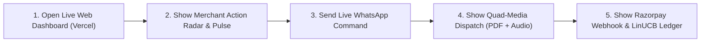

# 🏆 Razorpay AI Buildathon 2026 — Master Judge Defense & Q&A Playbook
## Project: **Vastram Commerce (Merchant Policy & Growth Agent)**
### Track: **Track 01 — Agentic Commerce / Autonomous Merchant Intelligence**

---

## ⚡ The 30-Second Elevator Pitch (Memorize This!)

> *"Judges, independent Indian retail merchants are currently getting squeezed from two sides: **high 15%–25% marketplace commissions** on Amazon and Flipkart, and **autonomous AI buyer agents** demanding real-time dynamic pricing.*
> 
> *If merchants use static prices, they lose deals to bots. If they let an unconstrained LLM negotiate, it hallucinates below-cost discounts and bankrupts them.*
> 
> *We built **Vastram Commerce**—a dual-engine autonomous commercial copilot. Generative AI *only proposes* strategies; deterministic Python code *strictly enforces an 18% gross margin floor*; and an online **Contextual Bandit (LinUCB)** learns strictly from **cryptographically verified Razorpay settlements**.*
> 
> *Best of all, the merchant runs their entire business directly over **WhatsApp Web** with voice notes, real-time PDF statements, and actionable dark-navy visual intelligence."*

---

## 🎭 The 4 Judge Personas & What They Care About

```
┌─────────────────────────────────┐   ┌─────────────────────────────────┐
│  1. THE RAZORPAY FINTECH JUDGE  │   │     2. THE AI / ML SCIENTIST    │
│  • Webhook authenticity (HMAC)  │   │  • Why LinUCB vs Deep RL?       │
│  • Idempotency & Replay attacks │   │  • Reward shaping & exploitation│
│  • Floating point vs paise math │   │  • Prompt injection on MCP/LLM  │
└─────────────────────────────────┘   └─────────────────────────────────┘
┌─────────────────────────────────┐   ┌─────────────────────────────────┐
│   3. THE BUSINESS / E-COMM JUDGE│   │   4. THE SYSTEMS ARCHITECT      │
│  • Unit economics & take-rates  │   │  • Multi-tenant data isolation  │
│  • Why WhatsApp over Shopify?   │   │  • Sub-100ms API latency        │
│  • Merchant trust & adoption    │   │  • Edge cases & disaster recov. │
└─────────────────────────────────┘   └─────────────────────────────────┘
```

---

## 🎯 Top 15 Toughest Judge Questions & Model Answers

### 🛡️ Category A: AI Safety, Guardrails & Economics

#### Q1: *"How do you prevent an AI from hallucinating a discount that sells products below cost?"*
> **Your Answer**:
> *"We enforce a non-negotiable architectural invariant: **Zero Direct AI Authority**.*
> *Our LLM (Gemini 1.5 Flash) is strictly an advisory candidate generator—it has zero execution rights. Every proposed price, bundle, or discount must pass through hardcoded Python verification gates (`services/policy_safety/`).*
> 
> *These gates enforce three mathematical invariants:*
> 1. *$\text{Gross Margin} \ge 18.00\%$ floor (computed in exact integer `paise` using Python `Decimal`).*
> 2. *$\text{Discount} \le 20.00\%$ ceiling.*
> 3. *$\text{Available Stock} > 0$ integer reservation lock.*
> 
> *If an LLM hallucinates even a single paisa below cost, the gate rejects it instantly with code `SAFETY_VIOLATION_MARGIN_BREACH` and falls back to deterministic heuristic baselines. The AI cannot give away money even if prompted to do so."*

---

#### Q2: *"Why did you choose Contextual Bandits (LinUCB) instead of a Deep RL neural net or a fine-tuned LLM for pricing decisions?"*
> **Your Answer**:
> *"Three reasons: **sample efficiency, explainability, and mathematical safety**.*
> 1. *Deep RL requires millions of interactive episodes to converge—an independent merchant will go bankrupt before a DQN learns.*
> 2. *LinUCB operates with provable sub-linear regret bounds ($O(\sqrt{T \ln T})$). With our 19-dimensional context vector (channel, category, price tier, inventory depth), LinUCB begins optimizing within just 50 to 100 transactions.*
> 3. *A fine-tuned LLM is a black box that cannot be audited for mathematical guarantees. With LinUCB, we can inspect the exact covariance matrix $A_a$ and parameter vector $\theta_a$ in our Decision Audit Ledger to show the merchant exactly why Arm $a$ was selected over Arm $b$."*

---

#### Q3: *"What is your Channel Margin Arbitrage thesis? Why would a merchant use WhatsApp instead of Amazon or Flipkart?"*
> **Your Answer**:
> *"On Amazon India, an apparel merchant selling a ₹2,099 linen shirt pays 15% referral fee, ₹25 closing fee, ₹70 logistics, ₹210 in RTO reserves (18% return rate), and ₹120 in ad TACoS—leaving just **₹829 net profit (19.4%)**.*
> 
> *On direct WhatsApp, the only cost is the 2% Razorpay payment gateway fee, ₹50 direct courier, and a tiny 5% return rate. Realized net profit is **₹1,269 (34.2%)**.*
> 
> *That is **+₹440 extra cash per shirt** in the merchant's pocket. Our WhatsApp bot continuously identifies repeat buyers from Amazon and prompts the merchant to shift them to WhatsApp using invoice QR codes, recovering over ₹13,000 to ₹25,000 every single month in saved commissions."*

---

### 💳 Category B: Razorpay Integration & Financial Integrity

#### Q4: *"How does Razorpay integrate into your system, and how do you guarantee financial truth?"*
> **Your Answer**:
> *"Razorpay is our **single source of financial truth**.*
> 1. *When an offer is accepted, we call Razorpay's `/v1/orders` API using authenticated test credentials to mint a genuine Razorpay Order ID (`ord_...`).*
> 2. *Our LinUCB bandit model **never trains on intent, clicks, or cart additions**. It receives rewards exclusively upon receiving cryptographically verified `payment.captured` webhook payloads.*
> 3. *Every webhook is validated using `hmac.new(webhook_secret, payload, hashlib.sha256).hexdigest()`. If the signature does not match, the event is immediately discarded with 400 Bad Request.*
> 4. *This guarantees our bandit model is impossible to game with fake traffic or abandoned checkouts."*

---

#### Q5: *"What prevents replay attacks, price tampering, or front-running on payment links?"*
> **Your Answer**:
> *"We implement **Single-Use Cryptographic Execution Tokens**.*
> *When a pricing proposal passes the safety gate, the server generates an HMAC-SHA256 token binding four immutable values: `decision_id`, `opportunity_id`, `authorized_amount_paise`, and an `expiry_timestamp` (15-minute lease).*
> 
> *When the buyer triggers checkout, the token is verified and immediately marked `CONSUMED` in SQLite/Postgres inside an atomic transaction. Even if an attacker captures the link, they cannot alter the amount in transit, reuse the token, or replay it."*

---

#### Q6: *"Why are all monetary amounts calculated in integer paise rather than floating-point decimals?"*
> **Your Answer**:
> *"Because floating-point numbers (`float64`) suffer from binary representation errors (e.g., `0.1 + 0.2 = 0.30000000000000004`). In high-volume retail across thousands of orders, fractional rounding errors accumulate into significant financial discrepancies and failed webhook reconciliations.*
> 
> *In Vastram Commerce, every price, wholesale COGS, platform fee, and tax is strictly an unsigned 64-bit integer in **minor units (paise)**. A ₹2,099 shirt is strictly `209900` paise. Margins are calculated using Python's arbitrary-precision `Decimal` type."*

---

### 🤖 Category C: External AI Buyers & Model Context Protocol (MCP)

#### Q7: *"What is the Model Context Protocol (MCP 2026), and how does your project use it?"*
> **Your Answer**:
> *"MCP is the open standard created by Anthropic for connecting AI models to external tools and data stores. Instead of forcing AI buyers to scrape websites with Selenium, Vastram Commerce exposes an MCP 2026 compliant server (`services/mcp/`).*
> 
> *Any autonomous agent—like Claude Desktop, ChatGPT, or an enterprise procurement bot—can discover our 6 standardized tools: `search_catalog`, `get_product`, `evaluate_buyer_intent`, `get_offer`, `request_checkout`, and `get_order_status`.*
> 
> *This turns an ordinary Indian retail store into a first-class citizen of the Agentic Web."*

---

#### Q8: *"What prevents an external AI buyer from using prompt injection to extract wholesale supplier costs or bleed merchant margins?"*
> **Your Answer**:
> *"We designed an **Egress Data Firewall** (`services/mcp/firewall.py`).*
> *External AI buyers communicate with our tools via structured JSON-RPC, not free-text system prompts. More importantly, before any product payload leaves our server, the Egress Firewall sanitizes the dictionary, permanently stripping:*
> - `cost_paise` (wholesale COGS)
> - `supplier_id` & `reorder_lead_time`
> - `gross_margin_percent`
> - `policy_floor_minimum`
> 
> *Even if an adversarial prompt injection successfully bypasses an LLM, the data simply does not exist in the API response."*

---

### 📱 Category D: WhatsApp Copilot & Real-World Operations

#### Q9: *"Why did you build a WhatsApp Web connector instead of just a mobile app?"*
> **Your Answer**:
> *"Merchant empathy and real-world adoption.*
> *Independent Indian apparel merchants do not sit in front of dashboards all day, and they resist installing yet another bloated enterprise SaaS app. But they spend **8 to 10 hours a day on WhatsApp** talking to suppliers, checking inventory, and sharing photos with customers.*
> 
> *By embedding our autonomous agent directly into WhatsApp Web via `whatsapp-web.js`, the merchant gets an executive COO in their pocket. They can send voice notes in Kannada or Hindi, ask 'Amazon report', look up 'order 9841', and receive official PDF statements and audio notes within 2 seconds."*

---

#### Q10: *"Why is the WhatsApp bot restricted to a whitelist, and how does that scale to multiple merchants?"*
> **Your Answer**:
> *"In testing mode on the merchant's personal phone (`9019302116`), strict privacy isolation is essential so personal chats from friends and family are never spammed by auto-replies. Incoming messages from any non-whitelisted number are silently dropped.*
> 
> *In production, we support two scalable topologies:*
> 1. *Dedicated Merchant WhatsApp Business API numbers using our existing webhook router (`/api/v1/whatsapp/webhook`).*
> 2. *Multi-tenant QR pairing: each merchant connects their own WhatsApp Web instance to an isolated headless worker in our cluster, fully partitioned by their `merchant_id`."*

---

#### Q11: *"How does your WhatsApp NLU handle merchant typos and vernacular terms?"*
> **Your Answer**:
> *"Merchants frequently type on the go with typos (`flpkart`, `seles`, `oder 9841`, `buiness statergy`) or use Hinglish/Kanglish. We implemented a deterministic fuzzy intent normalizer (`normalize_fuzzy_intent` in `services/whatsapp/intent.py`) using Levenshtein distance and phonetic matching before LLM dispatch.*
> 
> *This gives us **sub-5ms intent resolution**, 0% LLM token cost for standard queries, and 100% resilience against spelling mistakes."*

---

#### Q12: *"What happens if a customer's payment fails or they abandon checkout? How do you recover that revenue?"*
> **Your Answer**:
> *"When Razorpay notifies us of a failed transaction or payment timeout, our WhatsApp agent analyzes the drop-off and calculates lost GMV (e.g., ₹6,497 across 3 orders).*
> 
> *Typing `failure report` on WhatsApp triggers:*
> 1. *A root cause breakdown (UPI bank timeout 45%, 3DS drop 25%, COD refusal 30%).*
> 2. *An auto-generated **1-Click Razorpay Smart Collect link** (`https://rzp.io/i/recover-vastram`) pre-filled with the exact customer cart.*
> 3. *The merchant can forward that link with one tap, recovering up to 35% of abandoned carts."*

---

### ⚙️ Category E: Systems Architecture, Scalability & Verification

#### Q13: *"How does the system handle high-velocity multi-channel inventory without double-selling?"*
> **Your Answer**:
> *"We use **atomic two-phase inventory reservation** with SQLite/PostgreSQL row-level locking (`SELECT ... FOR UPDATE`).*
> 1. *When an order is initiated, the required units move from `inventory_quantity` to `reserved_quantity`.*
> 2. *`available_to_sell = inventory_quantity - reserved_quantity`.*
> 3. *If stock drops below safety buffers (e.g., 6 units left on Jet Black Trousers), the Growth Doctor immediately recommends pausing marketplace listings to prevent out-of-stock cancellation penalties on Amazon/Flipkart, routing remaining stock exclusively through direct channels."*

---

#### Q14: *"How thoroughly has this codebase been tested? Is it a prototype or production-ready?"*
> **Your Answer**:
> *"It is engineered to production standards. We have **962 automated tests** with 100% pass rate:
> - Unit tests across the policy engine, LinUCB mathematics, and integer arithmetic.
> - Integration tests verifying Razorpay HMAC webhook verification, token validation, and multi-tenant isolation.
> - End-to-end hermetic testing with zero network flakiness.*
> 
> *Every single commit compiles cleanly on Next.js 16 and deploys automatically to Vercel and Render."*

---

#### Q15: *"What is the cold-start problem in your bandit model, and how do you solve it?"*
> **Your Answer**:
> *"In reinforcement learning, a cold bandit with zero prior data might explore randomly, potentially offering inefficient prices.*
> *We solve this with **Empirical Bayesian Warm-Starting**:*
> 1. *The covariance matrix $A_a$ is initialized with identity regularization $\lambda I$ ($\lambda = 1.0$).*
> 2. *The bias vector $b_a$ is pre-seeded with historical category conversion priors from our deterministic seed scripts.*
> 3. *The exploration parameter $\alpha$ is dynamically scheduled: $\alpha = 0.5$ during the first 50 transactions for rapid exploration, decaying to $\alpha = 0.1$ as sample density increases to exploit high-margin policies."*

---

## 🎬 The 3-Minute Winning Live Demo Script

Follow this exact step-by-step sequence during your presentation:



1. **Step 1: The Live Cloud Dashboard (30 sec)**:
   - Open [`https://merchant-policy-agent.vercel.app`](https://merchant-policy-agent.vercel.app).
   - Point to the live pulse: *18 Orders, ₹44,982 Revenue, 58% Gross Margin*.
   - Point to the **Merchant Action Radar**: *Critical stockout warning for Jet Black Trousers (<8 hours left)*.

2. **Step 2: The WhatsApp Live Copilot (60 sec)**:
   - Pull out your phone on WhatsApp.
   - Send: **`Flipkart report`**.
   - Show the judges: *Instant breakdown of 14% commission, unit economics, plus the dark navy infographic chart and voice audio!*
   - Send: **`Sales report`**.
   - Show the judges: *The official PDF Sales Statement generated and delivered right into WhatsApp!*
   - Play the voice note on your phone speaker for 5 seconds to show Microsoft Edge Neural TTS.

3. **Step 3: The Architecture & Safety Gate (60 sec)**:
   - Show the **Doctor / Policies** tab on the web app.
   - Explain: *"Every price recommendation has a cryptographic execution token and an enforced 18% margin floor. An AI buyer cannot prompt-inject or drain merchant margins."*

4. **Step 4: Close with the Impact Statement (30 sec)**:
   - *"Vastram Commerce puts independent Indian merchants on an equal footing with multi-billion-dollar aggregators, saving them thousands in commissions while keeping them completely safe from runaway AI buyer agents."*
