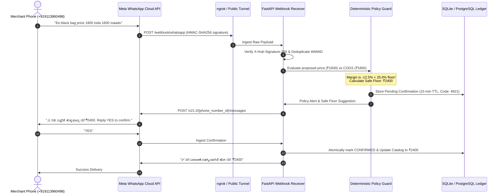

# Meta WhatsApp Business Platform Integration & Live Demo Guide

This document provides step-by-step instructions for demonstrating the **Merchant Growth Agent** via **WhatsApp** during hackathons and live evaluations.

---

## 1. Architecture Overview



---

## 2. Meta WhatsApp Cloud API Setup (Live Hackathon Mode)

### Step 1: Create Meta Developer App
1. Go to [developers.facebook.com](https://developers.facebook.com) and log in.
2. Click **My Apps** > **Create App**.
3. Select **Other** as the use case > Click **Next**.
4. Select **Business** as the app type > Click **Next**.
5. Enter an App Name (e.g. `Merchant-Growth-Agent-Demo`) and choose your Business Account.

### Step 2: Add WhatsApp Product
1. On the App Dashboard, scroll to **WhatsApp** and click **Set up**.
2. Go to **WhatsApp** > **API Setup** on the left sidebar:
   - Copy the **Temporary Access Token** (or create a permanent System User token in Business Settings).
   - Copy the **Phone Number ID** (e.g. `1029384756...`).
   - Copy the **WhatsApp Business Account ID**.

### Step 3: Add Merchant's Personal Phone to Meta Test List
> [!IMPORTANT]
> Because Meta test numbers are in sandbox mode until you add a paid credit card, you must add your personal phone as an authorized test recipient:
1. In **API Setup**, look for the **To** dropdown under "Send and receive messages".
2. Select **Manage phone number list**.
3. Add your phone number: `+919113960498` (or your personal mobile number).
4. Meta will send an SMS or WhatsApp verification code to your phone. Enter the code to verify.

### Step 4: Configure Webhook
1. Start an ngrok tunnel to expose your local FastAPI backend (port 8000):
   ```bash
   ngrok http 8000
   ```
   Copy the Forwarding URL (e.g. `https://a1b2-c3d4.ngrok-free.app`).

2. In the Meta Developer Portal, go to **WhatsApp** > **Configuration**:
   - Click **Edit** under **Webhook**.
   - **Callback URL**: `https://<your-ngrok-url>/webhook/whatsapp`
   - **Verify Token**: `vastram_growth_agent_verify_2026`
   - Click **Verify and Save**. (Meta sends a GET request with `hub.challenge`; the backend validates and returns 200 OK immediately).
3. Under **Webhook fields**, click **Manage** and subscribe to **`messages`**.

### Step 5: Update Your `.env` File
Add your Meta credentials to `.env`:
```env
WHATSAPP_ACCESS_TOKEN=EAAG...your_meta_token_here
WHATSAPP_PHONE_NUMBER_ID=your_meta_phone_number_id_here
WHATSAPP_BUSINESS_ACCOUNT_ID=your_meta_waba_id_here
WHATSAPP_VERIFY_TOKEN=vastram_growth_agent_verify_2026
WHATSAPP_APP_SECRET=your_meta_app_secret_here
WHATSAPP_TEST_MERCHANT_PHONE=+919113960498
WHATSAPP_DEFAULT_MERCHANT_ID=merch_atlas_travel
```

---

## 3. Live Hackathon Demo Walkthrough

Once configured, send real messages from WhatsApp on your phone (`+919113960498`) to Meta's test business number:

### Scenario 1: Deterministic Policy Margin Guardrail (Kannada)
- **Send**: `Ee black bag price 1800 inda 1600 maadu`
- **Expected WhatsApp Response**:
  ```text
  ⚠️ ನೀತಿ ಎಚ್ಚರಿಕೆ (Policy Alert): ₹1600 ಬೆಲೆ ನಿಗದಿಪಡಿಸಿದರೆ ನಿಮ್ಮ ಲಾಭಾಂಶವು -12.5% ಆಗುತ್ತದೆ (ಅಸಲು: ₹1800), ಇದು ಕನಿಷ್ಠ ಮಿತಿ 25% ಗಿಂತ ಕಡಿಮೆ.

  🛡️ ಸುರಕ್ಷಿತ ಪರ್ಯಾಯ ಬೆಲೆ: ಕನಿಷ್ಠ ಮಾನ್ಯ ಬೆಲೆ ₹2400 ಆಗಿದೆ.
  ಈ ₹2400 ಬೆಲೆಯನ್ನು ಖಚಿತಪಡಿಸಲು YES ಎಂದು ಉತ್ತರಿಸಿ ಅಥವಾ ಬೇರೆ ಬೆಲೆಯನ್ನು ಕಳುಹಿಸಿ.

  ದೃಢೀಕರಣ ಕೋಡ್: 4921
  ```
- **Send**: `YES` (or `CONFIRM 4921` / `HOWDU`)
- **Expected WhatsApp Response**:
  ```text
  ✅ ಬೆಲೆ ಬದಲಾವಣೆ ಯಶಸ್ವಿಯಾಗಿದೆ!

  📦 ಉತ್ಪನ್ನ: Atlas All-Weather Travel Backpack (35L)
  💰 ಹಿಂದಿನ ಬೆಲೆ: ₹2999
  🎉 ಹೊಸ ಬೆಲೆ: ₹2400

  ಮಾರಾಟ ವ್ಯವಸ್ಥೆ ಮತ್ತು ವೆಬ್‌ಸೈಟ್‌ನಲ್ಲಿ ತಕ್ಷಣವೇ ಅಪ್‌ಡೇಟ್ ಆಗಿದೆ.
  ```

---

### Scenario 2: Compliant Price Modification (English)
- **Send**: `Change backpack price to 2500`
- **Expected WhatsApp Response**:
  ```text
  📝 Confirm Price Change

  📦 Product: Atlas All-Weather Travel Backpack (35L)
  💰 Current Price: ₹2400
  🎯 Proposed Price: ₹2500
  📈 Projected Margin: 28.0% (Policy compliant)

  Reply CONFIRM <code> or YES to apply.
  Reply CANCEL to discard. (Expires in 15 mins)
  ```
- **Send**: `YES`
- **Expected Response**: `✅ Price Successfully Updated! New Price: ₹2500`

---

### Scenario 3: Real-Time Stock Query (Kannada or Hindi)
- **Send**: `Stock eshtu ide nodu`
- **Expected WhatsApp Response**:
  ```text
  📊 ಪ್ರಸ್ತುತ ದಾಸ್ತಾನು ವರದಿ (Inventory Status):

  🟢 Atlas All-Weather Travel Backpack (35L): 30 ಯೂನಿಟ್‌ಗಳು (₹2500)
  🟢 Shock-Resistant 16-Inch Laptop Sleeve: 50 ಯೂನಿಟ್‌ಗಳು (₹799)
  🟢 Ergonomic Multi-Device Bluetooth Mouse: 40 ಯೂನಿಟ್‌ಗಳು (₹999)
  🟢 7-in-1 Aluminum USB-C Travel Hub: 25 ಯೂನಿಟ್‌ಗಳು (₹1499)
  🟡 Atlas Executive Ballistic Nylon Pack (42L): 15 ಯೂನಿಟ್‌ಗಳು (₹4999)
  ```

---

### Scenario 4: Stock Addition
- **Send**: `Add 25 stock to backpack`
- **Expected WhatsApp Response**:
  ```text
  📦 Confirm Inventory Addition

  Product: Atlas All-Weather Travel Backpack (35L)
  Current Stock: 30 units
  Adding: +25 units
  Total New Stock: 55 units

  Reply CONFIRM <code> or YES to execute, or CANCEL to abort.
  ```

---

### Scenario 5: Single-Use & Replay Defense
- **Send**: `YES` (again after previous confirmation)
- **Expected WhatsApp Response**:
  ```text
  ⚠️ This action has already been executed. Replay is blocked.
  ```

---

## 4. Web Dashboard Visualizer

You can also demonstrate all WhatsApp interactions live directly on the web interface:
1. Navigate to `http://localhost:3000/whatsapp` in your browser.
2. View the **Interactive Phone Simulator**, quick demo action pills, active 15-min TTL tokens, and live WAMID deduplication log.
